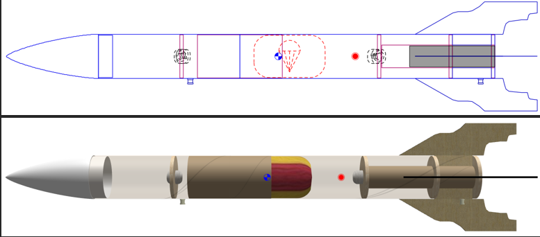
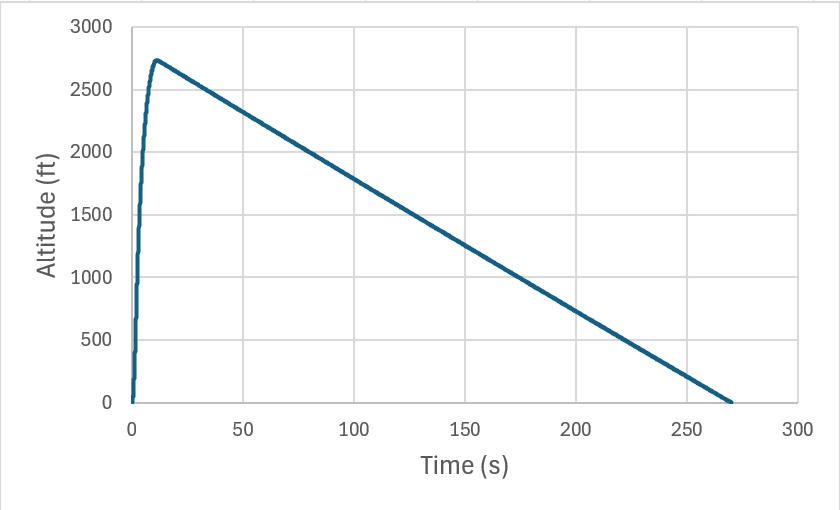

# NAR Level 1 Certification Rocket

**Independent Engineering Project · September 2026–Present**

**Tools:** OpenRocket; SOLIDWORKS planned for nose-cone design  
**Status:** Preliminary design and simulation; construction and certification flight pending

## Project Overview

I am currently working on designing and modeling my own high-power rocket as I prepare for my National Association of Rocketry (NAR) Level 1 (L1) certification. For this project, my current work includes the following: designing the rocket's geometry, analyzing its expected flight performance and stability, choosing materials for construction, and planning the recovery system before moving on to building and launching it.

My goal is to design, build, and successfully recover an H-class-powered rocket without any damage. I want to apply what I've learned in engineering to a real rocket design through this project and gain hands-on experience taking it from the initial design stage all the way to launch and recovery.

## Rocket Design and Configuration

I used OpenRocket to create an initial design of my rocket and analyze its dimensions, weight distribution, and expected flight performance.

*Figure 1. Preliminary OpenRocket design showing the rocket configuration.*

My most up-to-date preliminary design includes the following parameters:

- **Rocket motor:** AeroTech H100W
- **Overall length:** 37.483 in
- **Maximum body diameter:** 3.13 in
- **Estimated mass with motor:** 30.1 oz
- **Recovery system:** Parachute with shock cords

For the rocket's construction, I'm focused on being cost efficient while still selecting materials that can perform well. I plan to use cardboard for the body and motor tubes, plywood for the fins and centering rings, and a 3D-printed PLA nose cone.

I chose cardboard tubes because they are affordable and easy to find, although their available sizes also influence the rocket's overall dimensions, including the outer and inner diameters of the body tube. I decided to use plywood for the fins, centering rings, and bulkheads because I can cut and assemble the parts with tools I already have access to. I plan to create the design for the nose cone in SOLIDWORKS and then 3D print it using PLA. This will allow me to make a more complex shape without needing specialized manufacturing equipment.

## Stability and Flight Performance

I used OpenRocket to run simulations to see how my rocket is expected to perform during flight. I looked at its stability, maximum altitude, velocity, and recovery performance to get a better idea of how the design would behave during launch and descent.

The table below shows the initial simulation results for my rocket using an H100W motor. These are the predicted values I obtained from an OpenRocket simulation, and so I will need to compare them with actual flight data once the rocket has been built and launched.

| Parameter | Predicted Value |
|---|---|
| Apogee | 2,737 ft |
| Maximum Velocity | 624 ft/s |
| Maximum Mach Number | 0.560 |
| Static Stability Margin at Mach 0.300 | 1.74 calibers |
| Maximum Acceleration | 457 ft/s² |
| Time to Apogee | 11.3 s |
| Total Flight Time | 270 s |
| Landing Velocity | 13.3 ft/s |

*Figure 2. Preliminary altitude versus time simulation.*

The simulation gave a static stability margin of 1.74 calibers at Mach 0.300. This suggests that the rocket should tend to realign with the relative airflow after small angular disturbances at the evaluated condition.

OpenRocket also gave me an initial idea of the path the rocket is expected to take and how the recovery system might perform. I plan to use these simulated results to make improvements to the design and help prepare for the actual launch.

## Recovery System

For the recovery system, I plan to use a parachute attached to the rocket with shock cords. The parachute is intended to deploy near apogee using the motor's delayed ejection charge. This ejection charge will split the rocket at the coupler and allow the parachute to deploy and safely descend the rocket using the shock cords attached to the lower and upper body tube.

Based on my initial OpenRocket simulation, the rocket is expected to be moving at approximately 7.14 ft/s when the parachute deploys and 13.3 ft/s when it lands. I will use these results to help evaluate and improve the recovery system as I continue working on the rocket design. Once the rocket is built, I will need to test the recovery system and compare the actual flight data with the simulation to see how well it performs and if any changes are needed.

## Model Assumptions and Limitations

My current results are all based on my OpenRocket simulation, and so the rocket's actual performance may be different depending on its final weight, center of gravity, construction, and weather conditions during launch.

I plan to update the simulation using the rocket's most up-to-date measured weight and center of gravity to get more accurate predictions before launching. I also understand that the stability margin I calculated only applies to one point in the flight, and so I will need to continue checking the rocket's stability throughout the rest of its trajectory as well.

## Next Steps

The project is still in the design and simulation stage. The remaining objectives include the following tasks:

- Finalizing the rocket geometry and material selection.
- Completing the SOLIDWORKS design of the nose cone.
- Fabricating and assembling the rocket components.
- Integrating and checking the recovery system.
- Conducting the NAR Level 1 certification flight.
- Comparing actual flight performance with preliminary simulation results.

Once I finish building and testing my rocket and obtain my NAR L1 certification, I plan to add photos, observations from the launch, and comparisons between my OpenRocket predictions and the actual flight results to this portfolio.

---

[← Back to Portfolio](../)
